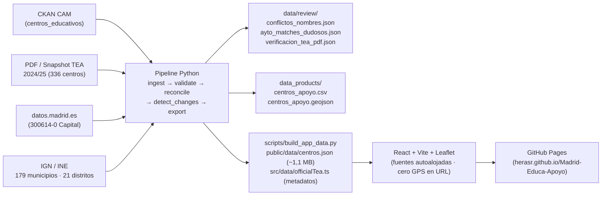

# Madrid Educa Apoyo

> **Buscador Educativo Accesible con Evidencia Oficial y Filtros Acumulativos**
> *Comunidad de Madrid — Atención Educativa Especializada · Proyecto cívico DataMad 2026*

[](https://github.com/herasr/Madrid-Educa-Apoyo/actions/workflows/update_resources.yml)
[](LICENSE)
[-1d4ed8.svg)](#-datos-cargados-y-procedencia)
[](https://herasr.github.io/Madrid-Educa-Apoyo/)

---

## 🌐 Demo pública (GitHub Pages)

Esta aplicación es un buscador estático sin servidor propio ni dependencias privadas. Se compila y despliega automáticamente mediante [`.github/workflows/update_resources.yml`](.github/workflows/update_resources.yml) sin pantallas de autenticación previa en:

- 👉 **[https://herasr.github.io/Madrid-Educa-Apoyo/](https://herasr.github.io/Madrid-Educa-Apoyo/)**

> **Nota de despliegue:** el repositorio requiere tener activado **Settings → Pages → Source: GitHub Actions** (o permisos de `enablement: true` en el token del flujo) y ejecutar el workflow en `main`.

---

## 🏗️ Arquitectura de datos y aplicación



---

## 📊 Datos cargados y procedencia

El proyecto cruza **tres conjuntos públicos abiertos y verificables** —más las referencias geográficas oficiales del IGN y el recurso educativo ONCE del catálogo autonómico— mediante el código oficial de centro (`28xxxxxx`) y contraste nominal/telefónico, con detección automática de discrepancias y trazabilidad de origen campo a campo:

| Conjunto / Fuente | Alcance y contenido | Licencia / Trazabilidad |
|---|---|---|
| **Portal de Datos Abiertos CAM** — [`Centros educativos de la Comunidad de Madrid`](https://datos.comunidad.madrid/catalogo/dataset/centros_educativos) | Fuente maestra del directorio (`TIPO_ABRV`, titularidad, dirección, teléfono, correo, web y coordenadas ETRS89 `EPSG:25830` → WGS84 para **432 / 433** entidades; `28081467` usa centroide oficial de Valdemoro). Aporta los **69 CEE** (`ALTA`), **14 Aulas Hospitalarias** (`4 ALTA` → `A1`, `10 EN TRÁMITE` → `A2`), **3 recursos de Discapacidad Visual** (EOEP Específico + CRE ONCE, `A1`), **10 recursos de Altas Capacidades** (CREACIM + EOEP `A1` y 8 sedes PEAC `A2`) y **3 EOEP Específicos regionales** (`28700741` Auditiva, `28700763` Motora, `28701214` TDAH/Lenguaje, `A1`). | CC BY 4.0 · Descarga automática vía CKAN con instantánea versionada y `fecha_descarga` determinista |
| **Consejería de Educación CAM** — [Relación de centros preferentes TEA con plazas previsibles](https://comunidad.madrid/sites/default/files/informacion_centros_preferentes_tea_curso_2024-25_0.pdf) (curso 2024/2025, 22/03/2024) | **336 centros preferentes TEA** (de los 682 preferentes TEA declarados en la región) en los que el aula atendía a menos de 5 alumnos o se preveía nueva apertura. | Ley 37/2007 RISP · Etiquetado como **A2 · oficial, por comprobar vigencia** ante el SAE; estado del PDF oficial registrado en `data/review/verificacion_tea_pdf.json` |
| **Ayuntamiento de Madrid (`datos.madrid.es`)** — [`Centros educativos en Madrid` (300614-0)](https://datos.madrid.es/egob/catalogo/300614-0-centros-educativos.csv) | Enriquece **152 centros ubicados en Madrid capital** con **transporte público** (Metro, EMT, Cercanías), **barrio**, equipamiento confirmado (**comedor**, **horario ampliado**, **transporte escolar**) y los códigos oficiales de `ACCESIBILIDAD` documentados en `estructura_ds_conjuntodatos.pdf` (`0`: no accesible, `1`: accesible, `2`: parcialmente accesible PMR, `3`: sin información PMR, `4`: lengua de signos, `5`: señalización podotáctil, `6`: bucle magnético). | Aviso Legal Ayto. Madrid (datos abiertos) · Solo cobertura en Madrid capital · Los cruces ambiguos (p. ej. teléfonos compartidos entre centros colindantes) se descartan en `data/review/ayto_matches_dudosos.json` |
| **Convenio CAM–ONCE + IGN/INE** | C.R.E. «Antonio Vicente Mosquete» dentro del registro CAM y nomenclátor oficial de los 179 municipios y 21 distritos de Madrid. | Información pública oficial / IGN |

**Transparencia sobre metodología, revisión de conflictos y límites de los datos:**
- **Resolución de conflictos nominales (caso `28020120` vs `28011258`):** El catálogo maestro CKAN de la Comunidad de Madrid prevalece en denominación, teléfono, correo y web (`28020120` = *Colegio Chamberí*, `28011258` = *Colegio Amor Misericordioso*). El listado TEA 2024/25 invierte estos dos códigos; `pipelines/ingest.py` detecta automáticamente cualquier divergencia nominal entre la fuente TEA y el registro maestro y la deja documentada en `data/review/conflictos_nombres.json` y en el campo `observaciones` de cada centro.
- **Control de falsos enlaces con `datos.madrid.es`:** Los cruces por teléfono o correo se validan contra la similitud nominal entre el centro CAM y el registro municipal para evitar mezclas erróneas cuando dos centros comparten contacto (como ocurrió anteriormente con `28012299` *CEE Alenta*). Los candidatos descartados quedan auditados en `data/review/ayto_matches_dudosos.json`.
- **Estado de la verificación del PDF TEA:** En el momento de la comprobación automática (`data/review/verificacion_tea_pdf.json`), la URL pública de la Comunidad de Madrid devuelve `HTTP 404 Not Found`, por lo que los cruces TEA se ejecutan sobre la instantánea versionada en el repositorio (`data/official/tea_preferentes_curso_2024-25.csv`, huella SHA-256 verificada) hasta que la Consejería publique un enlace actualizado.
- **Discapacidad Visual (`3` registros `A1`), Altas Capacidades (`10` registros) y EOEP Específicos (`3` equipos `A1`):** Para Discapacidad Visual no existe red de centros preferentes (se muestran el EOEP Específico y los centros CRE ONCE). Para Altas Capacidades se muestran CREACIM, EOEP y 8 sedes del programa PEAC. Para Auditiva, Motora y TDAH/Lenguaje no hay fichero abierto nominativo de preferentes en los 179 municipios, por lo que se muestran sus EOEP Específicos regionales oficiales junto con las guías ante SAE/DAT.
- **Escuelas de Bienvenida (Aulas de Enlace):** La incorporación temporal a Aulas de Enlace se tramita por Dirección de Área Territorial (DAT) / SAE sin conjunto abierto descargable, por lo que se ofrece guía oficial de tramitación (`0 · Vía SAE / DAT`).
- **Alcance municipal (`datos.madrid.es`):** El equipamiento y los códigos de accesibilidad PMR (`0..6`) proceden únicamente del Ayuntamiento de Madrid (`300614-0`). Fuera de Madrid capital, estos filtros se deshabilitan dinámicamente para no devolver ceros engañosos. Las fichas y exportaciones distinguen expresamente entre `Accesible (1)`, `Parcialmente accesible PMR (2)`, `No accesible (0)` y `Sin información sobre accesibilidad PMR (3)`.

### Ficheros de datos y colas de auditoría

- `data/official/tea_preferentes_curso_2024-25.csv` — relación de 336 centros preferentes TEA con su `.metadata.json`.
- `data/official/centros_educativos_datos_abiertos_cam.json` — subconjunto verificado del catálogo abierto CAM (433 entidades) con su `.metadata.json`.
- `data/official/ayuntamiento_madrid_centros_300614.csv` — instantánea UTF-8 de `datos.madrid.es` (`300614-0`) con su `.metadata.json`.
- `data/review/conflictos_nombres.json`, `ayto_matches_dudosos.json`, `verificacion_tea_pdf.json` — colas automáticas de revisión y verificación documental.
- `data/reference/` — centroides de respaldo de los 179 municipios (IGN) y 21 distritos de Madrid, generados con `scripts/build_geo_reference.py`.
- `data_products/` — productos reutilizables en **CSV** y **GeoJSON (RFC 7946, 433 registros)** con servicios, código de accesibilidad y observaciones incluidos.
- `public/data/centros.json` y `src/data/officialTea.ts` — catálogo JSON estático cargado de forma asíncrona (cacheable por separado del código JS) y módulo ligero de metadatos generados automáticamente con `scripts/build_app_data.py`.

---

## 🚀 Características Principales

1. **Filtros Acumulativos Transparentes y Dinámicos (Lógica AND entre dimensiones)**
   - **Catálogo escolar y equipos regionales (433 entidades únicas):** *Atención Preferente TEA* (`336`), *Educación Especial CEE* (`69`), *Atención Hospitalaria* (`14`), *Discapacidad Visual* (`3` · EOEP + CRE ONCE), *Altas Capacidades* (`10` · CREACIM + EOEP + 8 sedes PEAC), y los **EOEP Específicos CAM (`A1`)** de *Auditiva* (`1`), *Motora* (`1`), *TDAH* (`1`) y *Lenguaje (TDL/TEL)* (`1`), más *Ver todos* (`433`) y guía de trámite para *Escuelas de Bienvenida (Aulas de Enlace)* (`0 · Vía SAE / DAT`).
   - **Activación y deshabilitación inteligente:** Los filtros de **servicios**, **accesibilidad PMR** (`datos.madrid.es`), **titularidad privada** y **evidencia A1** se habilitan automáticamente donde existen datos de origen (Madrid capital, CEE/Hospitalaria, Visual o Altas Capacidades) y se desactivan con aviso transparente cuando el ámbito actual carece de cobertura.
   - Etapas educativas (Infantil, Primaria, ESO y Bachillerato cuando procede en PEAC) con conmutador **Cualquiera / Debe impartir todas**, indicando que en Infantil el PDF TEA solo consigna 3 centros exclusivamente de esa etapa mientras los CEIP/CEIPSO también imparten Infantil.
   - Ámbito territorial: **Toda la Comunidad**, **Solo municipio**, **Distrito en Madrid capital** o **Radio geodésico (Haversine)** desde municipio o geolocalización bajo demanda.

2. **Privacidad desde el Diseño**
   - Sin peticiones automáticas de ubicación GPS al abrir la web.
   - Si el usuario activa *«Cerca de mí»*, su coordenada se redondea a ~110 m y **nunca** se escribe en los parámetros de URL compartibles.
   - Las notas personales del Pasaporte Local se almacenan exclusivamente en el navegador (`localStorage`), sin envío a servidores externos.

3. **Accesibilidad, Lectura Fácil, Comparador y Pasaporte Local**
   - Mapa interactivo (Leaflet + OpenStreetMap) con dispersión en abanico (spiderfy) cuando coinciden varios centros en la misma ubicación, leyenda diferenciada e indicador visual A1/A2.
   - Modo **Lectura Fácil** que simplifica siglas (`CEIP`, `CEIPSO`, `IES`, `SIES`, `CEE`, `PT`, `AL`, `TIS`, `EOEP`, `SAE`) en lenguaje claro.
   - Jerarquía estricta de encabezados, regiones ARIA completas, gestión de foco accesible en todos los modales y contraste WCAG AA.
   - **Comparador objetivo** (máximo 3 centros) y **Pasaporte Local** orientativo imprimible/PDF.

4. **URL Reproducible y Exportación Abierta**
   - Sincronización de filtros territoriales y educativos en URL compartible.
   - Descarga directa en **CSV** y **JSON** con trazabilidad de fuentes, códigos oficiales de accesibilidad y distinción explícita entre dato confirmado y ausencia de fuente, además de los ficheros publicados en `data_products/`.

---

## 🛠️ Requisitos e Instalación

### Requisitos previos
- **Node.js**: v22.12+ (requerido por Vitest 5 y Vite)
- **npm**: v10+
- **Python**: v3.10+ (para ejecutar el pipeline de datos y `pytest`)

### Instalación local
```bash
# Instalar dependencias de la aplicación web
npm install

# Iniciar servidor de desarrollo (puerto 3000)
npm run dev
```

---

## 📊 Pipeline de datos (Python)

```bash
pip install -r pipelines/requirements.txt
python3 -m pipelines.ingest && python3 -m pipelines.validate && python3 -m pipelines.reconcile \
  && python3 -m pipelines.detect_changes && python3 -m pipelines.export && python3 scripts/build_app_data.py
```

- `ingest.py`: verifica la relación TEA (336) con auditoría de conflictos nominales frente al registro CKAN (`conflictos_nombres.json`) y estado del PDF oficial (`verificacion_tea_pdf.json`), descarga o lee `centros_educativos` de `datos.comunidad.madrid` (CKAN) usando la fecha real de la copia (`fecha_descarga`), normaliza los tipos vigentes (`CEIPSO`, `IES`, etc.), convierte coordenadas ETRS89 UTM30N (`EPSG:25830`) a WGS84 (`latitud`, `longitud`) y cruza centros de Madrid capital con `datos.madrid.es` (`300614-0`) descartando cruces ambiguos en `ayto_matches_dudosos.json`.
- `validate.py`: comprueba campos obligatorios, unicidad de códigos `28xxxxxx` y coordenadas válidas dentro de la Comunidad de Madrid para los 433 registros.
- `reconcile.py`: valida los municipios contra el nomenclátor oficial de 179 municipios de la Comunidad de Madrid.
- `detect_changes.py`: compara el hash SHA-256 del catálogo respecto a la ejecución anterior.
- `export.py`: genera `data_products/centros_apoyo.csv` y `data_products/centros_apoyo.geojson` (433 features) incluyendo servicios, accesibilidad física, código oficial Ayto (`0..6`) y observaciones.
- `scripts/build_app_data.py`: genera `public/data/centros.json` (catálogo asíncrono desacoplado del bundle inicial) y `src/data/officialTea.ts` (solo metadatos) para la aplicación web.

El flujo de GitHub Actions (`.github/workflows/update_resources.yml`) se ejecuta automáticamente en cada `push`/`pull_request` y semanalmente cada lunes: ejecuta el pipeline Python, valida la integridad con `pytest`, corre la suite de pruebas web y de accesibilidad (`axe-core`), verifica tipos TypeScript estrictos (`npm run lint`), compila la aplicación (`npm run build`) y la despliega en GitHub Pages en la rama principal.

---

## 🧪 Pruebas y Validación

El proyecto combina pruebas del pipeline Python (`pytest`) con una suite React/Vitest + `@testing-library/react` + `axe-core` (WCAG 2A/2AA) que valida el motor de filtros (`FIL-001` a `FIL-012`), la integridad de las 433 entidades oficiales, la resolución de conflictos (`28020120` / `28011258`), el bloqueo de falsos enlaces municipales (`28012299` CEE Alenta), los códigos de accesibilidad Ayto (`0..6`), la gestión de foco en modales, el modo Lectura Fácil y la privacidad en URLs compartibles:
```bash
# Pruebas unitarias del pipeline Python (ETRS89→WGS84, conflictos, falsos enlaces, integridad JSON)
python -m pytest -v

# Suite de pruebas web + componentes + accesibilidad WCAG AA (Vitest + axe-core)
npm test

# Comprobación estricta de tipos TypeScript y compilación de producción
npm run lint && npm run build
```

---

## 🎤 Presentación DataMad (guion de 3 minutos y métricas clave)

- **Problema:** Las familias con necesidades de apoyo educativo en la Comunidad de Madrid tienen la información fragmentada entre PDFs de Centros Preferentes TEA, el catálogo CKAN regional y los ficheros municipales de `datos.madrid.es`, sin una herramienta unificada ni accesible.
- **Solución:** Buscador estático 100 % open-source (`0 €` de infraestructura) con trazabilidad campo a campo (A1/A2), lógica acumulativa real, mapa con dispersión en abanico, Lectura Fácil, Pasaporte Local privado y descarga abierta en CSV/GeoJSON.
- **Cifras verificadas en el repositorio:**
  - **433** entidades y equipos oficiales unificados (**336** TEA, **69** CEE, **14** Aulas Hospitalarias, **10** Altas Capacidades, **3** Discapacidad Visual y **3** EOEP Específicos CAM).
  - **432 / 433** centros con coordenada oficial ETRS89 `EPSG:25830` convertida a WGS84 (`1` con centroide oficial de Valdemoro).
  - **152** centros en Madrid capital enriquecidos vía `datos.madrid.es` (`300614-0`) con transporte, servicios y código PMR (`0..6`).
  - **Actualización semanal automatizada** los lunes vía GitHub Actions, con fuentes autoalojadas (`@fontsource`) para evitar peticiones a terceros al cargar.
- **Hoja de ruta abierta:** integración automatizada de próximos PDFs TEA que publique la Consejería en `comunidad.madrid` y extensión de enriquecimiento de servicios a más municipios conforme publiquen ficheros abiertos equivalentes a `300614-0`.

---

## 👥 Autoría y Licencia

Desarrollado como iniciativa cívica abierta para **DataMad 2026**.

- **Código fuente:** Licencia [Apache 2.0](LICENSE).
- **Datos públicos integrados:**
  - *Centros educativos de la Comunidad de Madrid* (`datos.comunidad.madrid`), bajo licencia **CC BY 4.0**.
  - *Relación de centros preferentes TEA* (Consejería de Educación, Comunidad de Madrid), reutilización conforme a la Ley 37/2007.
  - *Centros educativos en Madrid* (`datos.madrid.es`, conjunto `300614-0`, Ayuntamiento de Madrid).
  - *Centros ONCE / C.R.E. «Antonio Vicente Mosquete»* e *IGN/INE* para georreferencia municipal.

